

  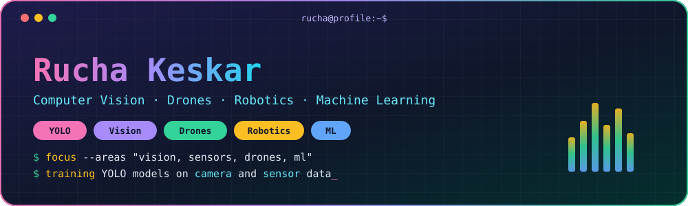

  
  
  
  
  
  

  
  
  
  
  

---

## 👋 About me

I'm **Rucha Keskar**, a third-year B.Tech Computer Engineering student at **IITM Pune**. I work where **computer vision, drones, and machine learning** meet: training object-detection models on camera and sensor data.

- 💼 **HPC Intern**, IITM Pune
- 🤝 **Core Team**, Google Developer Groups (GDG) On Campus, VPKBIET
- 🏆 I enjoy competing in technical hackathons
- 🎯 Looking for **Tier-1 internships and research opportunities**

---

## 👁️ Focus areas

| 🎯 Area | 🔍 What I work on |
|---|---|
| **Computer Vision** | Training **YOLO** object-detection models on camera images and video |
| **Drones** | Analysing data from drone sensors and cameras, including the SIH 2026 search-and-rescue project |
| **Robotics** | Using sensor data to understand and respond to the physical world |
| **Machine Learning** | Building models on sensor and image datasets |
| **Full-Stack Web** | Building web apps with HTML, CSS, and JavaScript |

<!-- TODO: add any libraries you use for vision or ML, e.g. OpenCV, PyTorch -->

---

## 🛠️ Tech stack

**Languages:** Python · Java · JavaScript · HTML · CSS

**AI & Vision:** YOLO · Computer Vision · Machine Learning <!-- TODO: add frameworks you use, e.g. PyTorch, OpenCV -->

**Tools:** Git · GitHub · VS Code · PyCharm · Anaconda

---

## 🖼️ Gallery

### 🚁 Drones & Robotics

<table>
<tr><td align="center" width="50%">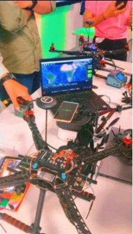 <b>Drone build</b></td><td align="center" width="50%">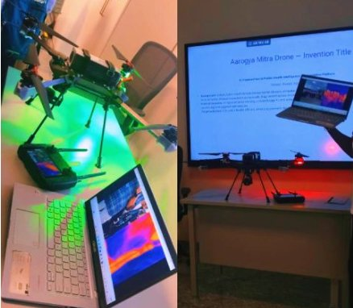 <b>Aarogya Mitra drone with thermal feed</b></td></tr>
<tr><td align="center" width="50%">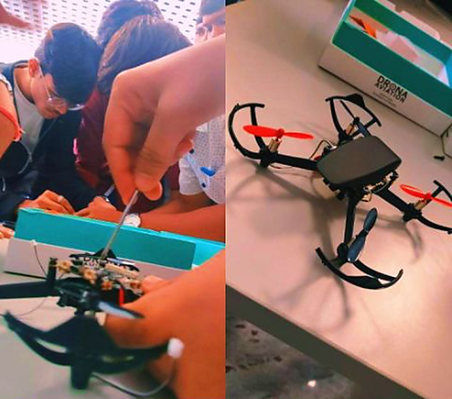 <b>Drone assembly workshop</b></td><td align="center" width="50%">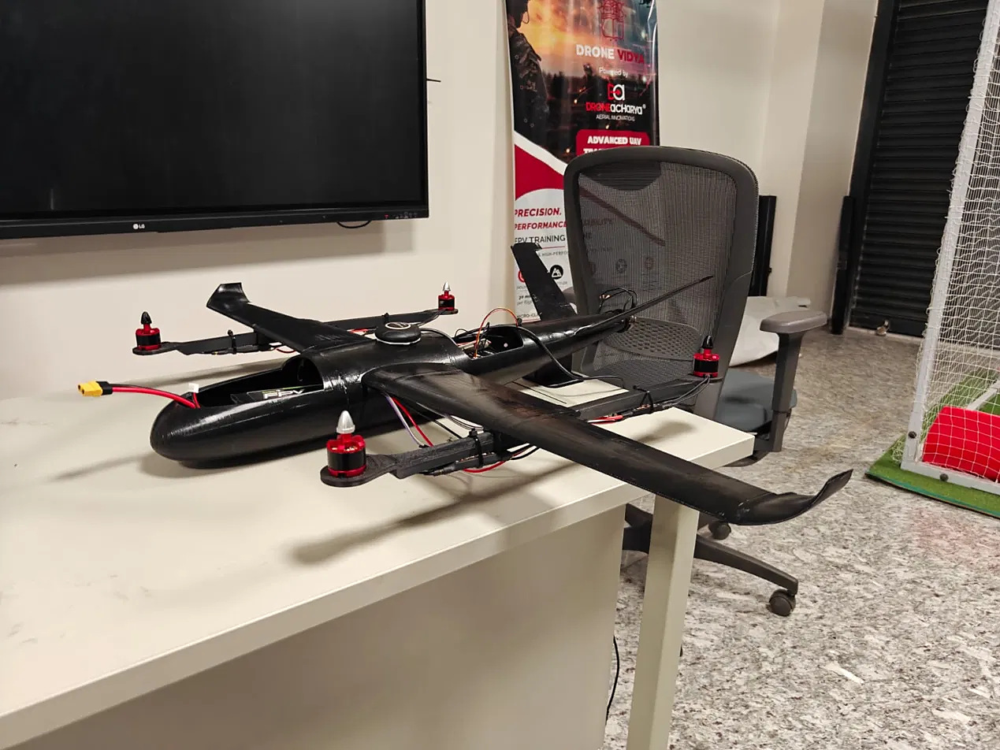 <b>Fixed-wing drone</b></td></tr>
<tr><td align="center" width="50%">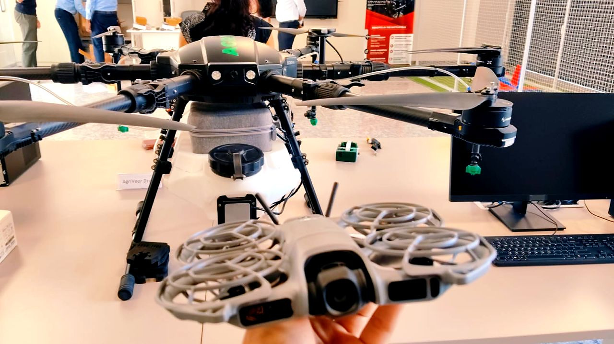 <b>AgriVeer drone lab</b></td><td align="center" width="50%">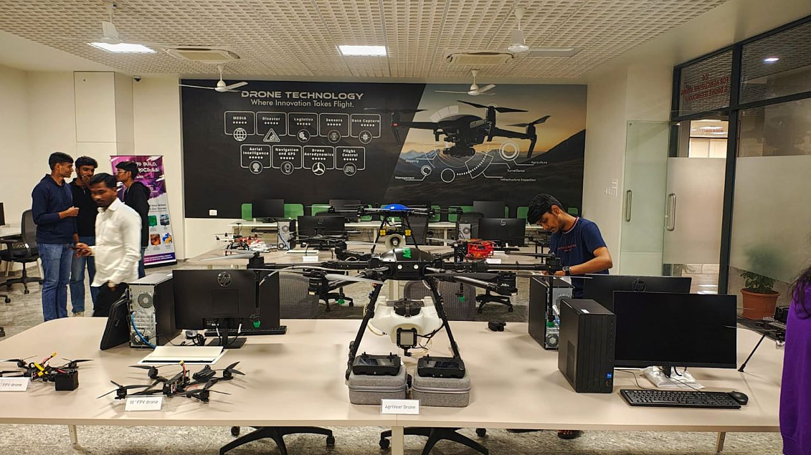 <b>Drone lab workbench</b></td></tr>
<tr><td align="center" width="50%">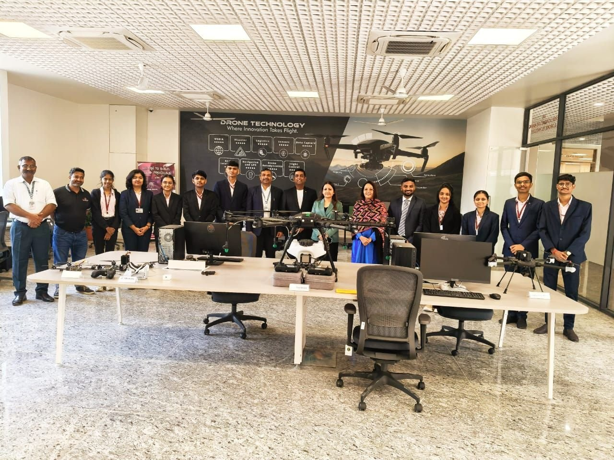 <b>Drone lab team</b></td><td align="center" width="50%">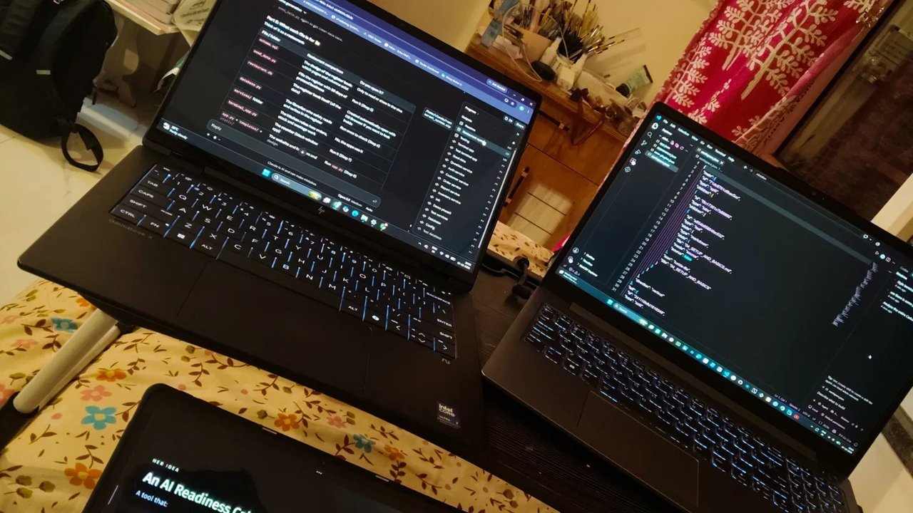 <b>Development workstation</b></td></tr>
</table>

### 💻 AI & Software Projects

<table>
<tr><td align="center" width="50%">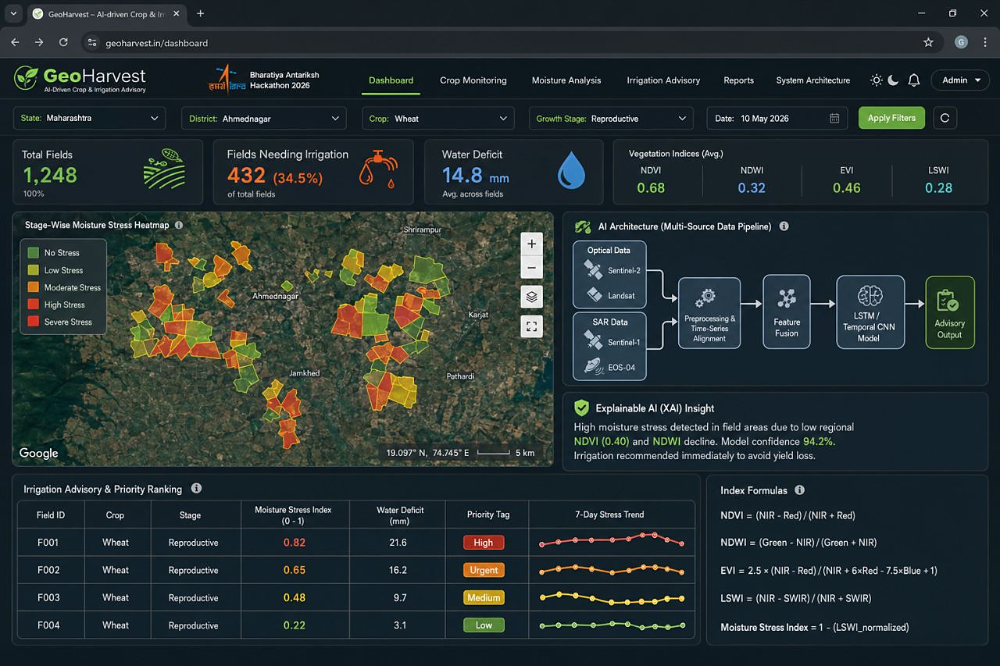 <b>GeoHarvest: AI crop and irrigation dashboard</b></td><td align="center" width="50%">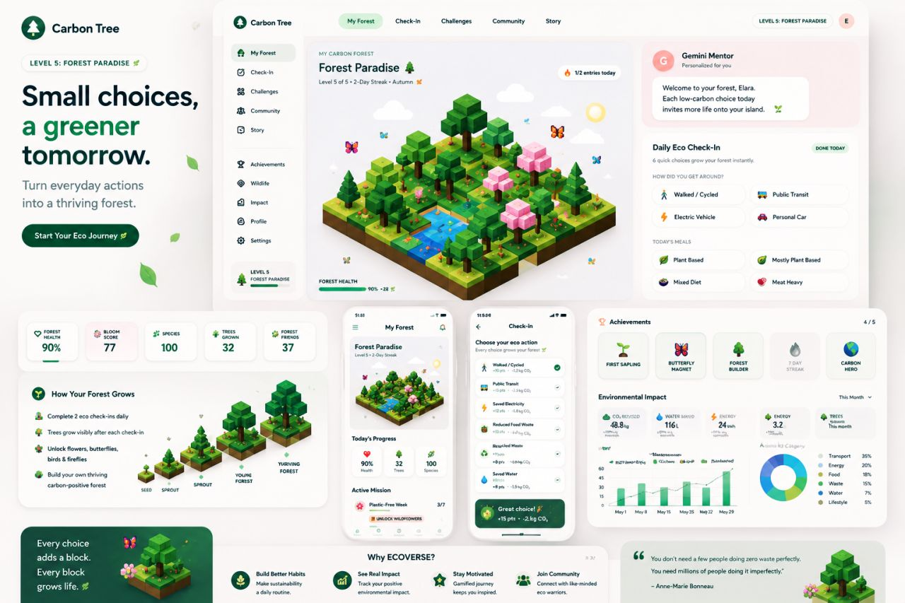 <b>ECOVERSE and Carbon Tree UI</b></td></tr>
</table>

### 🏆 Awards & Events

<table>
<tr><td align="center" width="50%">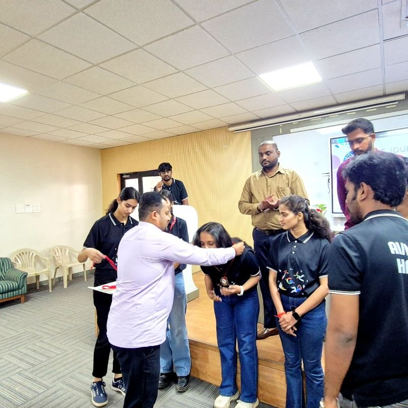 <b>Award ceremony</b></td><td align="center" width="50%">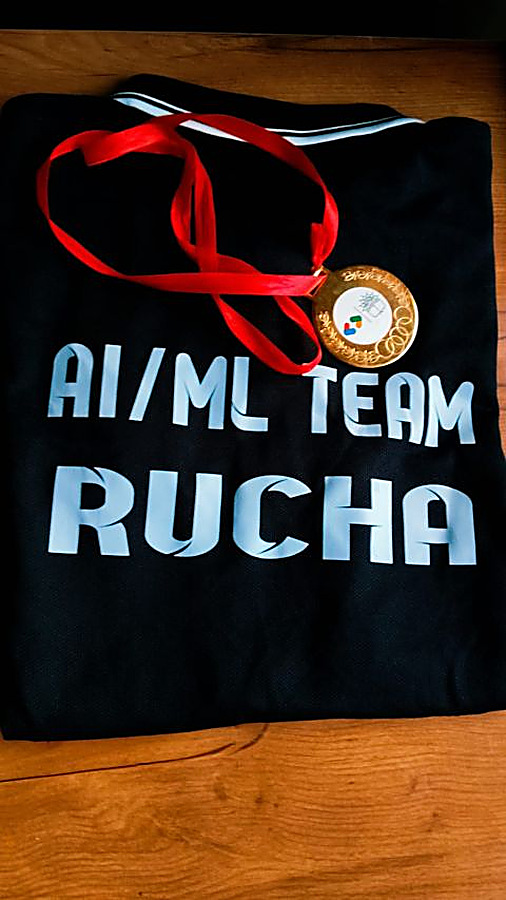 <b>AI/ML Team medal</b></td></tr>
<tr><td align="center" width="50%">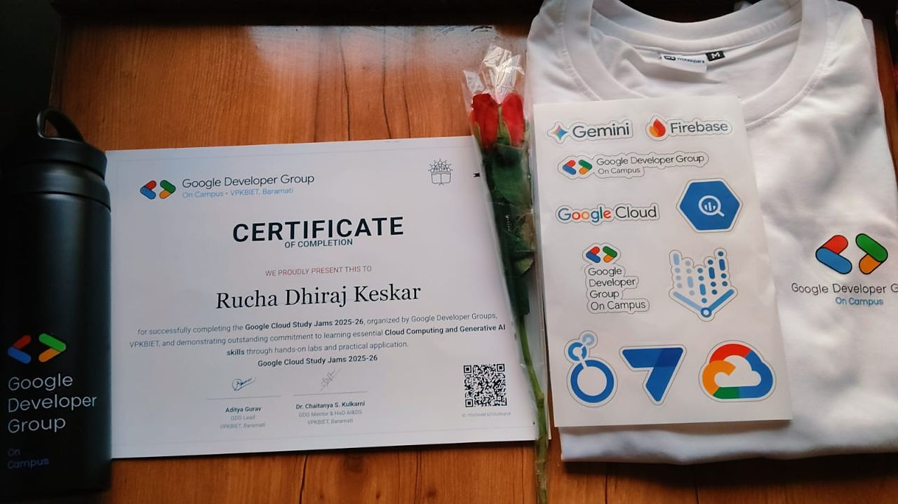 <b>GDG Cloud Study Jams certificate</b></td><td align="center" width="50%">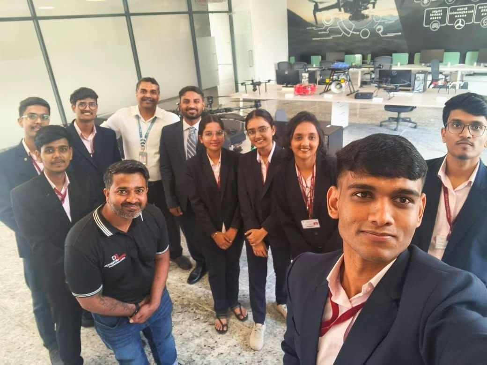 <b>Team at the drone lab</b></td></tr>
</table>

---

## 🚀 Projects

More coming soon.

---

## 📫 Connect with me

  
  

---

  

